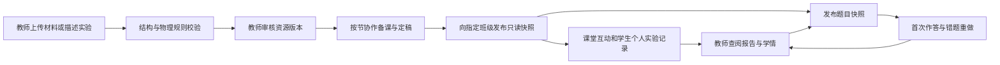
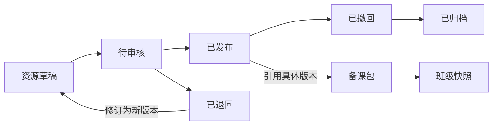
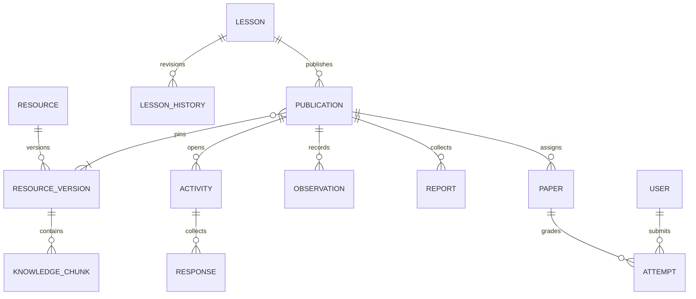

# 定值电阻课例与答辩验收

## 教学流程与记录

备课包使用按节乐观并发控制。不同章节可分别保存；同节冲突显示服务器文本，编辑者比较后再保存。每次修订追加历史版本。定稿或发布后继续编辑，会产生新的可编辑版本。回滚同样产生新草稿。

## 角色和数据边界

| 角色 | 可操作的对象 | 可查阅的结果 |
|---|---|---|
| 学生 | 所属班级的开放活动、个人观察、报告和客观题作答 | 本人实验、首次答案与重做记录，小组讨论中的同组发言 |
| 教师 | 同组材料、负责或受邀编辑的备课包、任教班级课堂与练习 | 任教班级报告、原始作答、首次与重做统计 |
| 教研组长 | 教学功能、受邀协作的备课包及本组资源治理 | 本组审核与操作记录 |
| 审核员 | 本组资源审核、退回、撤回及归档 | 材料来源、版本、审核意见与组内审计 |
| 管理员 | 账号启停、角色与班级分配、新账号、生成任务配置、任务恢复 | 运行任务、全局审计与资源 |

发布时复制教学章节、资源版本、附件标识、实验初值和调节范围。试卷复制题干、标准答案、知识点与干扰项标签。学情看板对每题第 1 次作答及第 2 次以后的作答分别统计，分母为实际提交次数。资源阅读按学生主动打开材料的次数累计。探究结论由教师在“过程记录”查阅。

## 答辩演示路线

1. **准备材料。** 林老师在“AI 演示工坊”提出固定电阻实验要求。查看生成来源与预览；未接模型时应显示“本地模板”。查看引用片段，然后到资源库审核通过。记下资源版本。
2. **备课与发布。** 在“协作备课”新建备课包，复用电学模板，勾选一个审核通过的交互演示及实验指导，指定陈老师为协作者。两人同时打开同一节编辑，一人先保存，另一人比较冲突文本后提交。定稿并向九年级一班发布，记下快照版本。
3. **核对物理结果。** 两个独立会话分别登录学生。固定 10 Ω 时，张明记录 1 V、0.1 A，李悦记录 3 V、0.3 A。分别提交观察与探究报告。教师在“过程记录”看到两组，学生只能看见本人记录。教师修改备课草稿后，回到已发布课堂核对原快照。
4. **组织互动。** 教师发起投票，学生提交后刷新页面，核对计数与已选答案。截止后尝试新提交。分组讨论按班级名单每四人分一组，组员可多次发言；教师查看各组记录。
5. **从错题到反馈。** 使用示范课堂的随堂巩固卷，或在新课堂自行组卷。学生第一次选错，打开“我的错题本”重做答对。教师在“学情分析”运行统计，查看首次 0/1、重做 1/1 和错因，再按同一知识点追加练习。
6. **说明边界。** 使用二班学生账号验证一班课堂不可访问。查看任务中心的恢复记录和运行管理的拒绝日志。备课包可导出 Word 或 PDF，下载后核对课题、章节、版本与引用材料。

## 可复核的测试与研究记录

### 2026 年 11 月 24 日本机验收

| 检查 | 实际结果 |
|---|---|
| 自动集成测试 | Windows、Python 3.12、隔离 SQLite 数据库。8 项测试全部通过，耗时 14.00 秒。 |
| 教室读数 | 在浏览器中以教师身份打开示范课。10 Ω、1 V 显示 0.1 A；调至 3 V 后电表和推导显示 0.3 A。 |
| 权限、协作与发布 | 测试确认二班学生访问一班记录返回 403，同节并发编辑返回 409，后续草稿修改和资源撤回均保留原课堂快照。 |
| 练习反馈 | 测试中首次错误、重做正确分别计为 0/1、1/1；重复提交同一请求只保存一次。可回查原题、所选答案和学生。 |
| 部署与异步任务 | Compose 的 Web、API、PostgreSQL、Redis 和 Celery worker 均启动。通过网页 API 检索到 3 段授权来源，独立 worker 完成本地模板生成、PDF 导出和班级学情统计。 |
| 实时课堂 | 在本机 Nginx 入口连接 WebSocket 后发布课例投票，从发起 HTTP 请求到收到开放状态耗时 765 毫秒。此值是单次本机观测。 |
| 生成规则与恢复 | 受控模型响应测试覆盖非法范围修复后成功、超时回退和继续对话；任务取消后可恢复。真实部署使用未配置外部模型时的本地模板路径。 |

示范课堂已保留一项开放投票，资源库另有一份经过校验、等待教师审核的演示。验收用的学生作答、错误与重做记录使用临时测试数据库，正式演示时可由学生账号现场产生。

运行 README 中的 pytest 命令，在独立数据库完成 API、WebSocket、后台任务与导出检查。测试正向用例、参数越界、重复请求、同节冲突、发布隔离和跨班访问。运行产生的时间与数据取决于设备；交互延迟需在实际演示环境中测量。建议保留测试命令和结果、课堂快照版本、实验记录与错题统计截图，作为论文系统测试材料。

教师访谈需在获得实际反馈后记录时间、参与者角色、问题与原话摘要。可结合本课例询问教师如何挑选可信资源、共同备课时怎样处理修改冲突，以及判断学生是否理解控制变量法时需要看哪些数据。访谈结论与真实课堂教学效果须由实际调研和试用产生。
